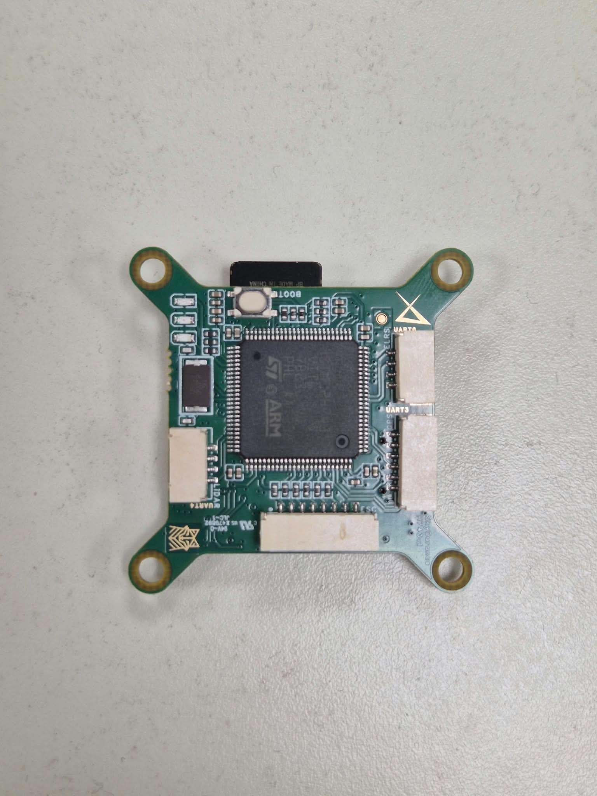
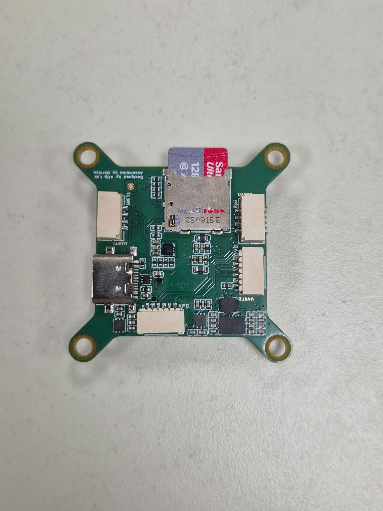

# AbsoluteEdge PX4 Flight Controller

Custom PX4/NuttX board support for an STM32H743-based flight controller. I brought the custom PCB from firmware bring-up to bench validation and flight testing.

## Hardware

| Front | Back |
| :---: | :---: |
|  |  |

## My contribution

- Created the PX4 board target and USB bootloader configuration: clock tree, linker and NuttX settings, pin mapping, DMA, startup code and firmware packaging.
- Integrated BMI088 and BMI270 IMUs over SPI, an LPS22HB/LPS22HH-family barometer over I²C, battery voltage/current sensing, microSD, USB, GPS/RC/telemetry UARTs and RGB status LEDs.
- Configured four TIM1 PWM/DShot motor outputs, including a safe input state during reset.
- Added board-specific PX4 sensor startup, battery calibration and multicopter defaults.

The implementation was based on the public PX4 targets for [MicoAir H743](https://github.com/PX4/PX4-Autopilot/tree/main/boards/micoair/h743) and [MicoAir H743 V2](https://github.com/PX4/PX4-Autopilot/tree/main/boards/micoair/h743-v2), then adapted to this PCB's pinout and peripheral set.

### LPS22HB/LPS22HH I²C integration

The selected PX4 baseline did not recognize the pressure sensor fitted to this board. Using existing PX4 barometer drivers as a reference, I extended the LPS22HB I²C probe logic to accept the sensor's `0xB3` `WHO_AM_I` response and integrated it into board startup on I²C2.

## Current status

The controller boots PX4 and has been tested on a flying drone. The current PCB revision shows significant in-flight interference/noise, most likely related to PCB layout, power integrity or EMI; the root cause has not yet been confirmed. A PCB revision and renewed validation are required before production use.

## Flight tests

**PID tuning**

https://github.com/user-attachments/assets/d72dcd16-8c58-4aee-8d7e-94d5deac8763

**Outdoor tests**

https://github.com/user-attachments/assets/74d653a1-d538-45a1-9b81-c0f1fd5e79af

## Build targets

From the PX4-Autopilot root, with this repository under `boards/absoluteedge` and the included LPS22HB changes applied to the PX4 driver tree:

```sh
make absoluteedge_flight_controller_default
make absoluteedge_flight_controller_bootloader
```
